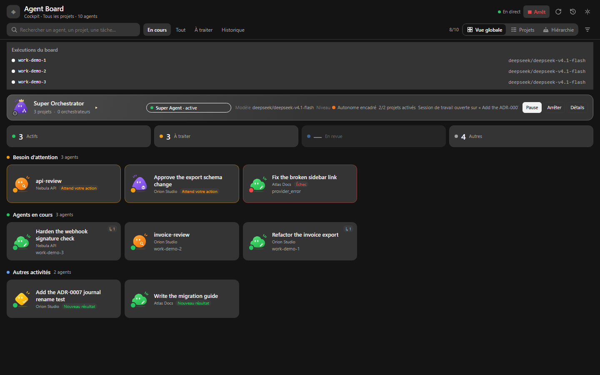
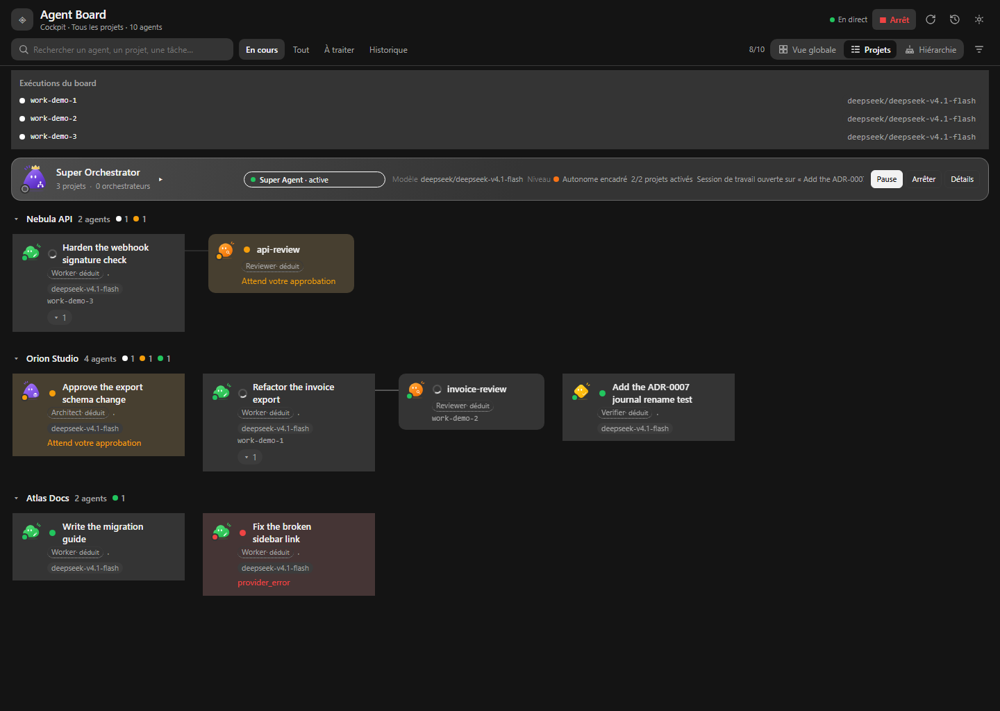
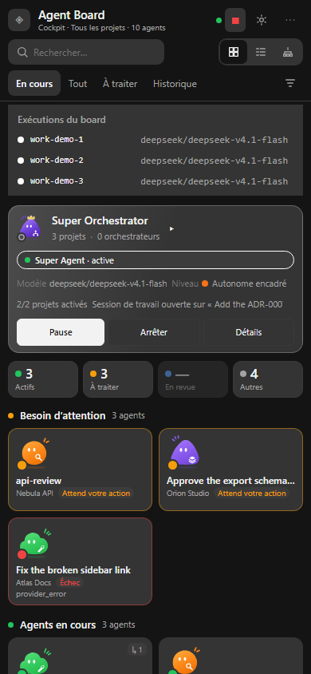

# Agent Board (DSH plugin)

A card-and-branch cockpit for **DeepSeek Harness**: one card per session and
sub-agent, grouped by project, with real native statuses and model/provider, a
supervisor that launches Task Board work in OFF / SUPERVISED / AUTONOMOUS modes,
a **Super Agent** that plans across projects from an explicit operator mandate,
a failover path that switches model/provider and hands the task off, a
**unified execution backend** that keeps the Task Board as the canonical
execution record while the board keeps the model failover, and an autonomy path
that **does not need the Task Board at all** (accepted ADRs, roadmap/TODO
checklists and forge issues become real dispatched work, with L4 backlog triage).

> **Status: PARTIAL (honest).** The supervision cockpit, the orchestration gates,
> the routing/budget/fencing layer and the unified execution contract are
> implemented and tested (see `docs/GOAL3-DELIVERY.md` for the exact evidence
> classes). The execution contract is a **proposed extension of the Task Board**
> and is currently proved against a **simulated** server
> (`tests/fixtures/fake-taskboard-server.mjs`): the real `dsh-taskboard` 0.12.0
> does not implement it yet, so `executionBackend:'contract'` is refused against
> it (`contract_unavailable`) and the two legacy backends remain the live paths.
> A real isolated DSH host was booted with a fake OpenAI-compatible provider and
> the full task → session → model turn → lease/attach/settle → `in_review` path
> was exercised **without user credentials**; a real provider outage and a real
> Task Board extension were **not** exercised. See
> [docs/LIMITATIONS.md](docs/LIMITATIONS.md) before trusting a claim.
>
> **GOAL 6 (Super Agent + explicit mandate):** a scope-aware mandate replaces the
> permissive legacy policy (`scopeMode: none | selected | all`, levels L0–L4,
> per-action grants, per-project model/priority/budget), every mutating path goes
> through ONE deterministic gate (`effectivePolicyOf`), a persistent Super Agent
> evaluates the multi-project portfolio, keeps directives and memory, and asks
> for human decisions instead of acting. The real installed profile was upgraded
> and verified inert (`schemaVersion:2`, `scopeMode:none`, L0). GitHub **writes**
> are implemented behind an explicit opt-in and validated live on a disposable
> repository; no merge/protected-push/delete exists. Full evidence, limits and
> rollback: [`docs/GOAL6-DELIVERY.md`](docs/GOAL6-DELIVERY.md).
>
> **GOAL 7 (autonomy without the Task Board):** the Super Agent no longer needs
> `dsh-taskboard` to advance a project. Accepted ADR follow-ups, roadmap/TODO
> checklists and open GitHub issues become **work items** dispatched with
> `launch_work` into real worker sessions, journaled by fingerprint (no loop, no
> duplicate). At maximum autonomy (L4) it can also **triage the backlog**:
> `promote_task` moves ONE unblocked, unassigned card out of `backlog` through
> the owner's native `taskboard_move`, never to `done`. Below L4 the operator
> answers a single-use approval. Evidence and limits:
> [`docs/audit/AUTONOMY-LEVEL-PROFILES-2026-11-14.md`](docs/audit/AUTONOMY-LEVEL-PROFILES-2026-11-14.md).
>
> **GOAL 4 (mascots + supervision):** the 15 approved mascots, the reusable
> `AgentAvatar`, the role-aware cards, the workspace → project → orchestrator
> hierarchy and the Super Orchestrator supervision layer are implemented and
> tested; the Task Board coordination stays read-only with documented proposals
> (`docs/MASCOTS-SUPER-ORCHESTRATOR.md`).
>
> **GOAL 5 (responsive cockpit):** the approved UX mockup is reproduced on the
> real plugin: global multi-project cockpit by default, compact header + one
> filter bar, real Super Orchestrator band, four runtime indicators,
> attention-first adaptive grid (240–290 px cards on desktop, two-column mosaic
> on mobile), desktop inspector drawer and mobile bottom sheet, light/dark
> themes, keyboard and container-query responsive behaviour. Evidence, measured
> sizes and every deliberate deviation are recorded in
> [`docs/GOAL5-DELIVERY.md`](docs/GOAL5-DELIVERY.md); the engineering contract is
> [`docs/UX-COCKPIT-CONTRACT.md`](docs/UX-COCKPIT-CONTRACT.md).

## Aperçu (données fictives)

Ces deux captures sont rendues par **le vrai client du plugin**, alimenté par un
jeu de données entièrement inventé (trois projets factices, aucune donnée
personnelle) : `node scripts/capture-demo-screenshots.mjs`. Les anciennes captures
réelles ont été retirées du dépôt **et de son historique** — voir
[docs/EVIDENCE-SCREENSHOTS.md](docs/EVIDENCE-SCREENSHOTS.md).



Vue **Projets** (1440×1024) : les sous-agents sont reliés à leur parent par les
connecteurs de l'arbre — deux branches visibles sur des projets factices.





## Branches

| Branch | Role |
|---|---|
| `main` | Stable line: starts at the MVP baseline (`ec955fb`) and carries the merged integration state — `main` and `dev` point at the same tree. |
| `dev` | Integration branch (default remote branch): GOAL 1 UX + GOAL 2 runtime audit/corrections + GOAL 3 supervision/orchestration + the goal-6/7 mandate and autonomy work (real executors for every non-human action, project-declared work without the Task Board, L4 backlog triage). This is the branch to build and try. |

Historical feature branches were merged into `dev`/`main` and their refs were
removed (nothing is lost: their commits are in `dev`'s history). They documented:

- **GOAL 3** (`goal3/supervision-orchestration`) — unified execution contract,
  layered routing/budget/fencing, supervision fidelity, adapters, benchmarks,
  independent reviews.
- **GOAL 4** (`feat/agent-board-mascots-super-orchestrator`) — the 15 Mascot SVGs
  byte-identical, role registry/aliases, `AgentAvatar`, role-aware cards +
  hierarchy + filters, the Super Orchestrator supervision layer and the Task Board
  coordination read model.
- **GOAL 5** (`feat/agent-board-responsive-cockpit`) — the responsive cockpit
  (global multi-project view by default, compact header/filters, Super
  Orchestrator band, runtime indicators, adaptive grid, inspector drawer / bottom
  sheet, two-column mobile mosaic).
- **GOAL 6** (`feat/agent-board-superagent`) — explicit mandate
  (scope/levels/actions), single policy gate, Super Agent runtime (identity,
  directives, memory, DecisionInbox), portfolio planning, Task Board public-v1
  client, opt-in GitHub writes, cockpit tabs.
- **GOAL 6/7 continuation** (`feat/superagent-ux-polish`,
  `feat/superagent-assessment-repair`) — level profiles applied on selection, real
  executors (native delete/schedule/merge/policy, GitHub PR with credential
  discovery and per-project repository), project-declared work items without the
  Task Board, L4 backlog triage.
- **Runtime fixes** (`fix/agent-board-runtime-e2e`, `fix/svg-byte-exact-checkout`)
  — GOAL 2 corrections/review rounds and the byte-exact SVG checkout.

The board **never merges, never pushes a protected branch and never deletes** on
a forge. It can open an issue/comment/PR **only** when the operator both enables
`allowGithubWrites` and grants the matching action in the mandate; those writes
are idempotent and audited. By default the forge is read-only and the Task Board
stays the sole owner of tickets and executions.

## What it does

- **Mascots & roles** — the 15 approved SVG roles (6 silhouettes, exact palette),
  resolved from a **declared** role/name first, then from the text the runtime
  already declares (session/goal/task title) with an ordered keyword table; a
  deduced role is always marked « déduit » and announced to assistive technology.
  A model never implies a role; only an agent with no declared role and no usable
  text keeps a neutral generic identity. The mascot colour is identity; runtime
  status is a separate dot. Assets are inlined as data URIs, so there is no
  external request and no CSP exception.
- **Supervision cockpit (default view)** — every project at once, attention first:
  a 52–60 px header, one 40–45 px filter bar (search, `En cours / Tout / À traiter /
  Historique`, view switch, filters popover), a 62 px Super Orchestrator band
  (official crowned mascot, real status, project/orchestrator counts, mini
  orchestrator avatars, expandable capabilities with reasons), four real
  indicators (`Actifs`, `À traiter`, `En revue`, `Autres`, each one a filter), and
  an adaptive grid of supervision cards. `En revue` is the linked Task Board
  `in_review` state and shows `—` with the reason when the ledger is unreadable;
  no percentage, no invented task, no fake activity is ever displayed.
- **Supervision** — a workspace-level Super Orchestrator **layer** (not an AI
  agent) that aggregates real project/agent/task facts, exposes blocks and
  cross-project dependencies, proposes (never applies) reassignments, and gates
  board-owned delegations with concurrency/hourly/depth/cycle limits. Besides the
  cockpit, the panel keeps a `Projets` view (tree, with mascots and roles) and a
  `Hiérarchie` view, with role/status/Task-Board-state filters.
- **Cards & branches** — sessions from the native `sessions.list` snapshot,
  sub-agents from the `subagentCatalog` projection and/or `parentId`, grouped by
  DSH workspace, collapsible sub-trees, compact mode, responsive down to a phone
  viewport with a two-column mosaic, DSH theme tokens (light/dark).
- **Exact statuses, with provenance** — `running` (animated ring),
  `waiting_user` (yellow, from `uiSession.sessionStatus.pendingInteraction`),
  `recovering` (route switch in progress), `interrupted` (an assignment was
  stopped/superseded or its session vanished), `provider_unavailable` (only when
  an injected provider-health table is inside its cooldown),
  `finished_unread` (green, until an explicit acknowledgement), `finished_read`
  (grey), `failed` (red, from the durable `turn/end` reason or the native
  lifecycle), `unavailable` (the runtime says the agent is gone), `idle`,
  `unknown` (a deleted session keeps `session_gone`, never “finished”).
  `recentlyFinished` is a view flag, not a status. Elapsed time never infers a
  status, and each card exposes the reason/source of its status. There is
  deliberately **no `waiting_agent`** status: DSH exposes no trustworthy
  per-parent wait signal (documented in `docs/ARCHITECTURE.md`).
- **Model / provider, honestly** — the card and inspector show the model the
  session really uses (native `modelSelection` projection) with a
  `native`/`assignment`/`unknown` source; a model change updates the chip and
  appends to the route history **without** creating a second card. A native
  session never borrows the board's route.
- **Click = inspect, explicit button = open** — a single click (or Enter) opens
  the inspector: a right-side drawer over the grid on desktop, a bottom sheet on
  mobile, with the last useful assistant segment, the expected action, the
  model/provider, the parent/children, the assigned task and an explicit
  “Open session” button that navigates through `uiWorkspace.openSession`.
- **Orchestration** — OFF (observe only), SUPERVISED (proposals wait for
  approval), AUTONOMOUS (launches inside the mandate), plus a separate
  **Stop executions** action that cancels in-flight agents and blocks new
  delegation until **Resume**. OFF, Stop, approval, manual dispatch and failover
  handoff all pass through host-side authorization gates.
- **Unified execution backends** — `board` (failover, no canonical record),
  `taskboard` (canonical record via the Task Board executor, model pinned) and
  `contract` (canonical record **and** failover: the board leases the execution,
  creates the session, attaches it, settles it; a handoff leases a second attempt
  with `previousExecutionId`). The contract backend refuses to run when the
  extension is absent instead of faking an execution.
- **Routing & budgets** — explicit chain, bounded retry honouring `Retry-After`,
  switch with allow-list/cooldown/local-only, handoff with a checkpoint,
  **return to the primary route** at a safe boundary, per-project layered policy
  (most-restrictive-wins; a conflict authorizes no route), and enforced
  concurrency/tasks/requests/retries/switches budgets. Token and cost are
  reported unavailable because no provider substantiates them.
- **Restart-safe** — assignments carry leases + fencing tokens + idempotency
  keys, a persisted JSON state and JSONL audit journal, a single-writer instance
  lock, a lease watchdog, and fencing that refuses a stale writer. A restart
  reconciles (never relaunches silently) and releases the Task Board lease of an
  interrupted attempt.
- **Autonomy without a Task Board** — accepted ADR follow-ups, roadmap/TODO
  checklists and open forge issues are detected as **work items** and dispatched
  into real worker sessions, one fingerprint per item (completed never replayed,
  failures retried with a delay and a cap). A `Proposed` ADR, a `[decision]` line
  or an assigned/decision-labelled issue is refused as `needs_human_decision` and
  shown in the panel instead of being guessed. At L4 the Super Agent can also
  promote one unblocked backlog card to `todo` per cycle, through the owner's own
  native tool, and never to `done`.
- **Security posture** — card text is delimited **data** (prompt-injection
  guard), a card can never widen its permission, every route goes through the
  connection trust gate, checkpoints are bounded and secret-redacted, no client
  module has an HTML sink, and no credential is read or logged. Full audit:
  `docs/SECURITY-AUDIT.md`.

## Requirements

- DSH `0.2.2-rc.1` (the only release this build was exercised on), Web GUI.
- Node.js `>=22` for the build/test scripts (`node --test`, no bundler, no
  runtime dependency).
- A DSH profile where the plugin can be added (the plugin never edits the DSH
  source tree).

## Install

The bundle is a normal DSH plugin (no DSH source changes):

```text
plugin_manager install_bundle  target=D:\App\DSH-agent-board
```

or from a shell:

```sh
dsh plugin --profile desktop add link:D:/App/DSH-agent-board
```

Then refresh the Web GUI once (client artifacts are served per page load).
The **Agent Board** entry appears in the global panel rail. Full procedure,
configuration table and rollback: `docs/INSTALL-ROLLBACK.md`.

Uninstall:

```text
plugin_manager remove_bundle  target=dsh-agent-board
```

State lives in `$DSH_HOME/agent-board/` (`state.json`, `audit.jsonl`,
`instance.lock`); remove that directory only when no DSH host is running to
forget read cursors, previews and assignments.

## Use

- **Panel** — click a card to preview, double-click (or “Open session”) to
  navigate. Collapse a sub-tree with the chevron; “Compact cards” switches to a
  flat one-line list.
- **Orchestration** — pick OFF, SUPERVISED or AUTONOMOUS. In SUPERVISED the
  board lists proposals with Approve/Reject; in AUTONOMOUS it launches ready
  tasks up to `maxConcurrent` and the hourly budget.
- **Stop executions** — separate from OFF: it cancels the live agents of the
  in-flight assignments and blocks new delegation (tick, dispatch, approval,
  failover) until **Resume**; switching mode does not lift a Stop.
- **Read cursors** — expanding an unread card (or reading the session in the
  native main view) posts an ack; the state is persisted host-side, so the card
  stays grey after a refresh.

## Mandate and Super Agent (GOAL 6)

After the upgrade the board is **inert by design**: `state.json` migrates to
`schemaVersion: 2` with `scopeMode: 'none'`, `level: 'L0'` and
`requiresConfiguration: true`; nothing launches until you configure the mandate
(cockpit → *Projets* tab, or `POST /dsh-agent-board/api/v2/mandate`).

- **Scope** — `none` (default) | `selected` (explicit workspace list) | `all`
  (requires the literal confirmation `ALL_PROJECTS`). An empty list never means
  “all”.
- **Levels** — `L0` observe, `L1` propose, `L2` supervised launch, `L3` routine
  autonomy (comment, create/update, schedule, push branch), `L4` critical
  (open PR, merge-triggering actions). The **most restrictive** rule wins:
  mode, stop, action grant, level, project state, integration ceiling.
- **Actions** — individual grants (`launch`, `launch_work`, `delegate`,
  `create_task`, `update_task`, `promote_task`, `comment`, `open_pr`,
  `push_branch`, `delete_task`, `schedule`); a level never implies an action.
- **Dry run** — `GET /dry-run` simulates one tick and returns, for every
  candidate, `allowed`/`reason`, the detected project work and the effective
  capability matrix.
- **Decisions** — the Super Agent never crosses the gate: it writes a
  DecisionInbox item, the operator answers, and an approval is **single-use**.
- **Directives & memory** — persisted operator directives (global/project) and a
  bounded memory digest; a project can pin its own model and hourly budget.

### The Task Board is optional (project-declared work)

The Super Agent does not need the Task Board plugin to advance a project. A
project already states its intent in files a human wrote, and those documents
are a first-class work source:

| Source | Read from | Becomes work when |
|---|---|---|
| `adr` | `docs/adr/*.md`, `docs/decisions/*.md`, `adr/`, `decisions/` | the ADR is **Accepted** and declares an unchecked follow-up (`- [ ]`) |
| `roadmap` | `ROADMAP.md`, `docs/ROADMAP.md`, `docs/roadmap.md`, `docs/next-steps.md`, `docs/plan.md` | an unchecked checklist line |
| `todo` | `TODO.md`, `BACKLOG.md`, `docs/TODO.md`, `docs/BACKLOG.md` | an unchecked checklist line |
| `issue` | the project's GitHub `origin` (open issues, when a credential is available) | the issue is open, not a PR, unassigned and not labelled `blocked`/`needs-decision`/`question` |

A detected item is dispatched with **`launch_work { workItemId }`** (minimum
level L2, automatic at L3+): the host re-resolves the id, checks readiness, then
opens one real worker session in the project directory with the project's
directives and the item's exact source. The assignment journals the item
fingerprint, so a completed item is never dispatched twice, a failed one is
retried with a delay (3 attempts max), and a **Proposed** ADR or an explicitly
marked item (`[decision]`, assigned/labelled issue) is refused with
`needs_human_decision` and reported in the panel instead of being executed.
When no credential exists the document sources keep working; the forge source is
simply empty.

### Backlog triage at maximum autonomy (L4)

`promote_task { reason }` is the only way a card leaves `backlog` without the
operator: at **L4 only** (below that, the operator answers a single-use bound
approval), the card must be `backlog`, unblocked, not waiting for a human, not
carrying `needsHumanDecision`, unclaimed, not running and have every
prerequisite `done`. It is executed through the owner's native `taskboard_move`
tool (`backlog → todo`, with `ifVersion`), journaled with its reason, commented
on the card, limited to 3 promotions per cycle and blocked for 6 h per card.
`done` remains unreachable: triage promotes work, it never accepts it.

### Minimum setup to see the Super Agent act (no Task Board)

1. Start the Super Agent and pick its model (cockpit → *Super Agent*), then set
   the mandate: `scopeMode: 'selected'`, the project workspace ids you want,
   `level: 'L3'` (routine autonomy) or `'L4'` (adds backlog triage + critical
   approvals), and `projects.<id>.enabled: true`.
2. Give the project something to declare: an **accepted** ADR with an unchecked
   `- [ ]` follow-up, or a `- [ ]` line in `TODO.md`/`ROADMAP.md`. A `Proposed`
   ADR is deliberately NOT dispatched: accepting it is your decision.
3. `GET /dsh-agent-board/api/v2/dry-run` must list it under `work.ready` with
   `writes: 0`. The *Vue d'ensemble* tab shows the same items ("Travail détecté").
4. Leave the mode on AUTONOMOUS: the next cycle dispatches one item per worker up
   to `maxConcurrent`, and the panel shows a normal session card.

`launch_work` requires `launch_work` **and** `launch`; a read-only project
(`allowedPermissions` without `workspace-write`) still dispatches, but the
worker is told to produce a change plan and never to claim the work is done.

Honest limits: the real Task Board public API is disabled without a token, so
public-v1 **writes** are not validated live; GitHub writes are validated on a
disposable repository only (see `docs/GOAL6-DELIVERY.md` §10). The new work
sources are proved by host tests, **not** by a live GUI run (the host modules
load at DSH startup and the local API requires a token).

## Configuration

The **mandate** (GOAL 6) is the canonical authorization source and is stored in
`state.json`; the legacy `/policy` endpoint is still accepted and translated
into the mandate (it can never widen a configured mandate). The policy below is
editable at runtime through the panel API and is persisted in `state.json`:

```http
POST /dsh-agent-board/api/v2/policy
{ "policy": { "executionBackend": "board",
              "maxConcurrent": 2, "maxRetries": 2, "maxSwitches": 2,
              "allowedWorkspaces": [], "allowedProviders": [],
              "allowedPermissions": ["read-only","workspace-write"],
              "allowCloudFallback": false,
              "routeChain": [{"provider":"opencode-go","model":"deepseek-v4.1-flash"}],
              "projectPolicies": { "ws-123": { "allowedProviders": ["opencode-go"], "maxSwitches": 1 } },
              "autonomyBudget": {"maxTasksPerHour": 6}, "requestsPerHour": 120,
              "retryCooldownMs": 300000, "maxAttemptsPerRevision": 4,
              "contractBoardReport": true } }
```

- `allowedWorkspaces: []` on the legacy policy means “every workspace visible”,
  but it is **translated conservatively** into an explicit selected scope: the
  mandate never treats an empty list as “all”.
- `executionBackend: "board"` creates the session itself (model-level failover
  possible); `"taskboard"` delegates to the Task Board executor
  (`POST /dsh-taskboard/tasks/:id/run`: execution record, permission, worktree)
  and explicitly gives up model failover; `"contract"` uses the proposed execution
  contract (`docs/TASKBOARD-CONTRACT.md`) to keep BOTH. The Task Board ledger is
  read-only from the board's perspective; `done` stays human-only.
- GitHub: no global repository is required anymore. Each project uses its own
  `remote origin` (a `githubRepository` config value becomes an optional pin: a
  different remote is then refused with `forge_project_mismatch`). Reads work as
  soon as a credential is usable: `githubToken` (config) → `GITHUB_TOKEN` →
  `gh auth token` (local CLI), governed by `githubTokenDiscovery`
  (`auto`/`env`/`off`). Writes require `allowGithubWrites: true` **and** the
  mandate action; the token is only ever sent to `api.github.com`, never logged,
  never published and never shown in the UI.

## Safety invariants

- `done` is never set by the board or a launched agent.
- The Task Board ledger is never written by the **execution path**: only the
  official `taskboard_*` tools act on it from the launched session, or the
  proposed execution contract (lease/attach/report/release/settle, never `done`).
  A public-v1 client (claim/attach/complete) is implemented and exercised against
  a real 0.12.0 build, but it is not yet the execution backend.
- One host owns `$DSH_HOME/agent-board` at a time (`instance.lock`); a secondary
  host serves reads and refuses mutations (409 `not_primary`).
- A card cannot widen its own permission beyond the policy mandate; a worktree
  card is skipped (board backend), delegated (taskboard backend) or run only in a
  lease-provided directory (contract backend) — never unisolated in the shared
  workspace.
- A stale writer cannot settle an assignment another writer owns (fencing); a
  Stop that lands during a launch/handoff wins the race.
- Forge **merge, protected-branch push and deletion do not exist**; issue,
  comment and PR creation require `allowGithubWrites` + the mandate action, are
  idempotent (project/type-namespaced keys) and audited.
- The JSONL audit rotates at 8 MiB (`audit.jsonl.1`, one generation) and records
  `audit_rotated`; older history is exported before it is truncated.

## HTTP API (same-origin, authenticated by the DSH browser session)

| Method | Path | Purpose |
|---|---|---|
| GET | `/dsh-agent-board/api/v2/state` | full board state + adapter matrix + contract + budget |
| GET | `/dsh-agent-board/api/v2/events` | SSE stream of the same state |
| GET | `/dsh-agent-board/api/v2/adapters` | capability matrix |
| GET | `/dsh-agent-board/api/v2/contract` | execution-contract negotiation (`?refresh=1` re-probes) |
| POST | `/mode` | `{mode: off\|supervised\|autonomous}` |
| POST | `/policy` | merge a policy patch (re-negotiates the contract when needed) |
| POST | `/stop` | cancel in-flight executions and block new delegation |
| POST | `/ack` | acknowledge one session (`{sessionId, seen?:false}`) |
| POST | `/tick` | run one orchestration tick now |
| POST | `/resume` | clear the operator stop (Stop is not OFF) |
| POST | `/dispatch` | `{taskId}` explicit manual launch |
| POST | `/proposals/:id/decide` | `{approve:boolean}` |
| GET/POST | `/mandate` | read / patch the explicit mandate (`scopeMode`, level, actions) |
| POST | `/mandate/confirm` | confirm the configuration (`requiresConfiguration:false`) |
| POST | `/mandate/projects/:id` | project override (enabled, level, model, budget, priority) |
| GET | `/dry-run` | simulate one tick: every candidate with `allowed`/`reason` |
| GET | `/diagnostics` | host diagnostics (state, lock, adapters, model discovery) |
| GET/POST | `/superagent`, `/superagent/start|stop|model|directive|cycle` | Super Agent runtime and controls |
| POST | `/superagent/decision` | answer a DecisionInbox item (approval is single-use) |
| POST | `/integrations/taskboard/probe` | real public-v1 negotiation (no secret returned) |
| GET | `/forge/checks/:ref` | read CI checks for a ref |
| POST | `/forge/issue`, `/forge/issue/:n/comment`, `/forge/pr` | opt-in GitHub writes (mandate + `allowGithubWrites`), idempotent |

Every request goes through `ctx.connection.requestRejection` before the
handler runs.

## Screenshots (integrated plugin, isolated DSH host)

Real captures of the plugin served by an isolated DSH host (simulated provider
and simulated Task Board, five workspaces, 21 real sessions):

- [1920 px, light](docs/EVIDENCE-SCREENSHOTS.md) ·
  [1920 px, dark](docs/EVIDENCE-SCREENSHOTS.md)
- [1366 px, light](docs/EVIDENCE-SCREENSHOTS.md) ·
  [1366 px, dark](docs/EVIDENCE-SCREENSHOTS.md)
- [390 px, light](docs/EVIDENCE-SCREENSHOTS.md) ·
  [360 px](docs/EVIDENCE-SCREENSHOTS.md) ·
  [320 px](docs/EVIDENCE-SCREENSHOTS.md)
- [desktop inspector drawer](docs/EVIDENCE-SCREENSHOTS.md) ·
  [mobile bottom sheet](docs/EVIDENCE-SCREENSHOTS.md)
- [projects tree](docs/EVIDENCE-SCREENSHOTS.md) ·
  [hierarchy](docs/EVIDENCE-SCREENSHOTS.md) ·
  [supervision details](docs/EVIDENCE-SCREENSHOTS.md)

GOAL 6 (mandate, Super Agent band, scope, settings, mobile, dark):

- [projects + scope](docs/EVIDENCE-SCREENSHOTS.md) ·
  [settings + effective permissions](docs/EVIDENCE-SCREENSHOTS.md) ·
  [super agent band](docs/EVIDENCE-SCREENSHOTS.md) ·
  [directives](docs/EVIDENCE-SCREENSHOTS.md)
- [dark](docs/EVIDENCE-SCREENSHOTS.md) ·
  [390 px](docs/EVIDENCE-SCREENSHOTS.md) ·
  [390 px settings](docs/EVIDENCE-SCREENSHOTS.md)

All nine captures and their captured facts: [GOAL6-UI-EVIDENCE.md](docs/e2e/GOAL6-UI-EVIDENCE.md).

## Tests

```sh
node --test tests/            # full suite, 570 tests (unit + contract + host + security + perf)
node scripts/build-assets.mjs # regenerate the inlined SVG data URIs (never hand-edit)
node scripts/build-client.mjs # regenerate src/client.js after editing src/client/**
node scripts/mascot-gallery.mjs # write an HTML gallery of the 32 approved SVGs
node scripts/smoke-host.mjs   # fast module/DAG smoke check
node scripts/e2e/run-e2e.mjs  # isolated real DSH host: migration + gate + failover + 3 projects
node scripts/e2e/github-live.mjs  # LIVE GitHub writes (needs GITHUB_TOKEN + a disposable repo)
node scripts/verify-live.mjs      # read-only status of both live integrations + real state
node scripts/bench/projection-bench.mjs   # 5/20/50/150 agents, 1000 sessions
node scripts/bench/payload-bench.mjs      # additive /state size (bounded sections)
```

## Documentation

- [Architecture](docs/ARCHITECTURE.md)
- [GOAL 6 delivery record (mandate, Super Agent, forge)](docs/GOAL6-DELIVERY.md) · [contract](docs/GOAL6-CONTRACT.md) · [Task Board public-v1 audit](docs/TASKBOARD-PUBLIC-V1-AUDIT.md)
- [GOAL 6 UI evidence](docs/e2e/GOAL6-UI-EVIDENCE.md) · [real-profile migration proof](docs/e2e/REAL-PROFILE-2026-11-12.md)
- [Responsive cockpit contract](docs/UX-COCKPIT-CONTRACT.md) · [GOAL 5 delivery record](docs/GOAL5-DELIVERY.md) · [independent review](docs/REVIEW-GOAL5.md)
- [Mascots, supervision & Super Orchestrator](docs/MASCOTS-SUPER-ORCHESTRATOR.md)
- [Contracts & adapters](docs/CONTRACTS.md)
- [Task Board execution contract (proposed, simulated)](docs/TASKBOARD-CONTRACT.md)
- [Task Board coordination (read-only, proposals)](docs/TASKBOARD-COORDINATION.md)
- [Failover, routing policy and budgets](docs/FAILOVER.md)
- [Agent engine adapters](docs/ADAPTERS.md)
- [Performance benchmarks](docs/PERFORMANCE.md)
- [Security audit](docs/SECURITY-AUDIT.md)
- [GOAL 3 delivery report](docs/GOAL3-DELIVERY.md)
- [Independent reviews](docs/REVIEW-GOAL3-BACKEND.md) · [supervision/UI](docs/REVIEW-GOAL3-SUPERVISION.md)
- [Install, configure, roll back](docs/INSTALL-ROLLBACK.md)
- [Operator next steps (live integrations, cleanup, real LLM cycle)](docs/OPERATOR-NEXT-STEPS.md)
- [Provenance & compatibility](docs/PROVENANCE.md)
- [Test report](docs/TEST-REPORT.md)
- [Known limitations & backlog](docs/LIMITATIONS.md)

## License

MIT — see [LICENSE](LICENSE) and [THIRD_PARTY_NOTICES.md](THIRD_PARTY_NOTICES.md).
