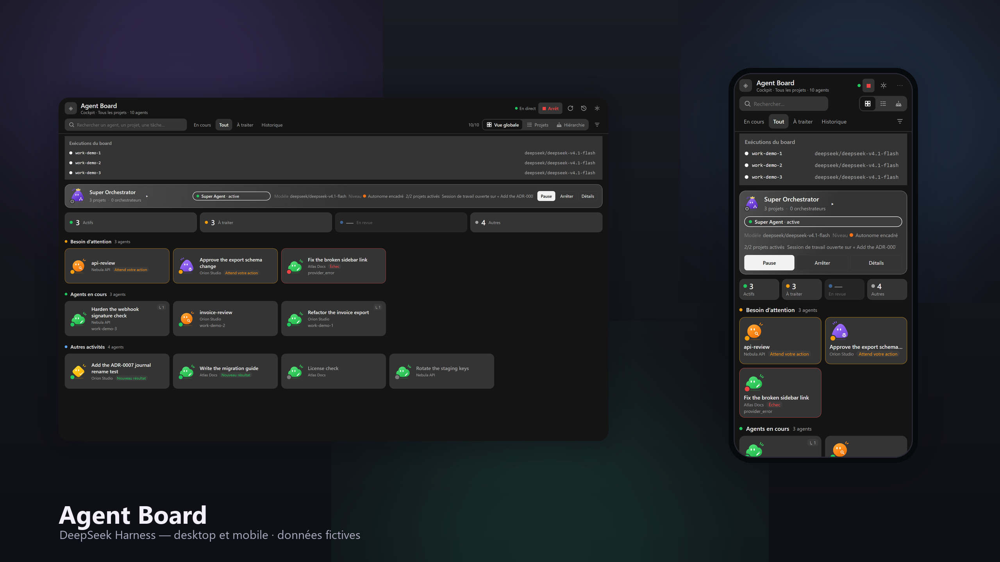
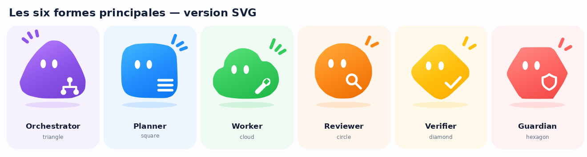
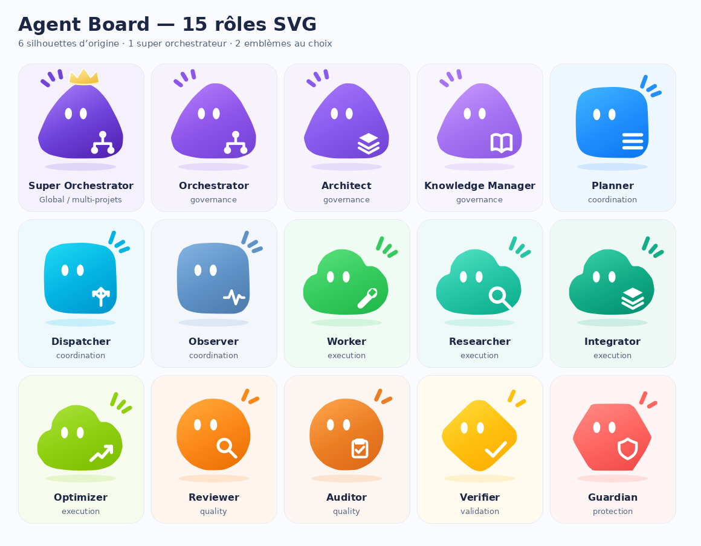
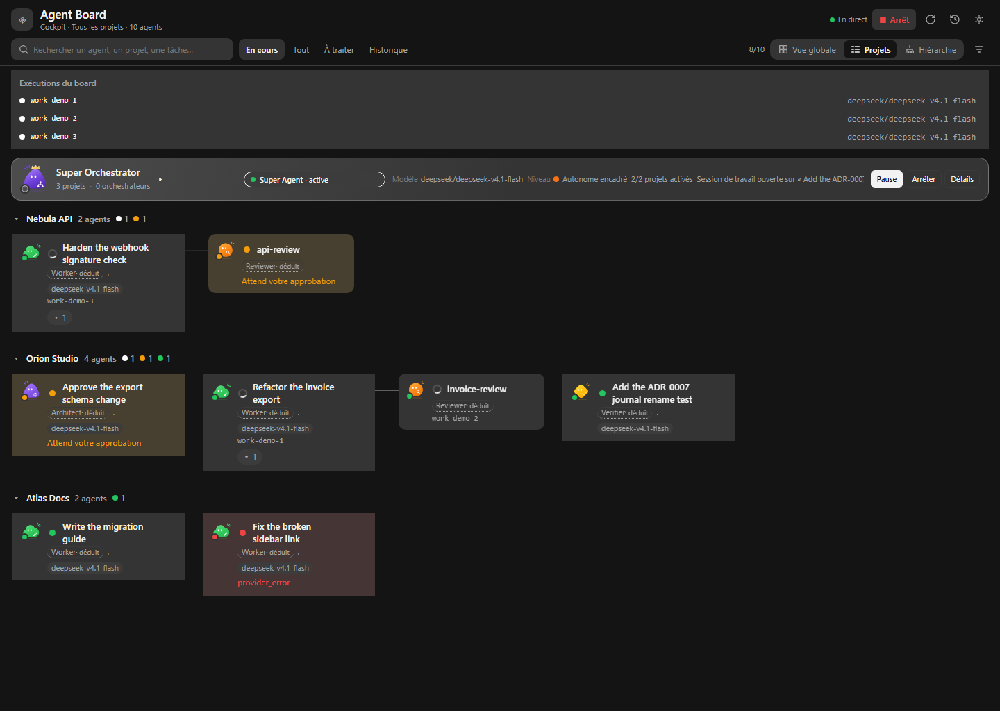
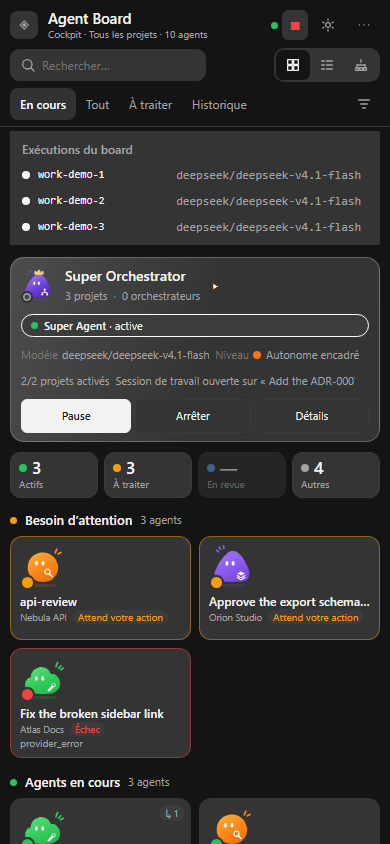

<p align="center">
  
</p>

<h1 align="center">Agent Board</h1>

<p align="center">
  Un cockpit de supervision pour <b>DeepSeek Harness</b> : une carte par session et
  sous-agent, un mandat opérateur explicite, et un Super Agent qui fait avancer de
  vrais projets — avec ou sans Task Board.
</p>

<p align="center">
  <code>Node ≥ 22</code> · <code>DSH 0.2.2-rc.x</code> · <code>MIT</code> ·
  plugin hôte + client · aucune dépendance d'exécution
</p>

<p align="center">
  <a href="README.md">English</a> · <b>Français</b>
</p>

> **À propos des captures :** elles sont rendues par le vrai bundle client du
> plugin avec un **jeu de données fictif** (aucun projet, session ou chemin
> personnel). Le hero est composé à partir des captures desktop et mobile ;
> régénérez l'ensemble avec `node scripts/capture-demo-screenshots.mjs` — voir
> [Captures d'écran](#captures-décran).

---

## Pourquoi il existe

DSH vous donne des sessions et des sous-agents puissants, mais rien qui réponde :
*qu'est-ce qui tourne, sur quel projet, avec la permission de qui, et que fera-t-il
ensuite ?* Agent Board ajoute cette couche sans remplacer le runtime : un cockpit,
une porte d'autorisation déterministe, et un Super Agent durable qui propose — et,
dans les limites de votre mandat, exécute.

| Ce que vous obtenez | En une ligne |
|---|---|
| **Cockpit** | Une carte par session et sous-agent, regroupées par projet, les points d'attention en premier, statuts et modèle réels. |
| **Mandat explicite** | `scopeMode` + niveau L0–L4 + autorisations par action. Refus par défaut ; rien ne se lance en dehors. |
| **Super Agent** | Une identité durable (mémoire, directives, décisions) qui évalue le portefeuille et agit dans le mandat. |
| **Exécution aux mains de l'opérateur** | L'agent écrit le contenu des cartes ; le prompt d'exécution, le modèle, la permission, l'isolation et le statut restent les vôtres. |
| **Autonomie sans Task Board** | Les ADR acceptés, les checklists roadmap/TODO et les issues ouvertes deviennent du vrai travail dispatché. |
| **Tri du backlog à L4** | Une carte backlog débloquée peut passer à `todo` via l'outil natif du propriétaire. Jamais à `done`. |
| **Exécuteurs réels** | Lancer, déléguer, commenter, créer/mettre à jour, planifier, supprimer, politique projet, PR GitHub, merge natif — chacun derrière sa propre porte. |
| **Sûreté auditable** | Verrou mono-écrivain, leases + fencing, approbations à usage unique, charges utiles liées par hash, audit JSONL. |

<details>
<summary><b>Table des matières</b></summary>

- [Ce qu'il fait](#ce-quil-fait)
- [Les agents](#les-agents)
- [Démarrage rapide](#démarrage-rapide)
- [Modèle d'autonomie](#modèle-dautonomie)
- [Travail déclaré par le projet (sans Task Board)](#travail-déclaré-par-le-projet-sans-task-board)
- [Tri du backlog à autonomie maximale (L4)](#tri-du-backlog-à-autonomie-maximale-l4)
- [Configuration](#configuration)
- [Invariants de sûreté](#invariants-de-sûreté)
- [API HTTP](#api-http)
- [Captures d'écran](#captures-décran)
- [Tests](#tests)
- [Documentation](#documentation)
- [Branches](#branches)
- [État et limites honnêtes](#état-et-limites-honnêtes)
- [Licence](#licence)

</details>

## Ce qu'il fait

- **Mascottes et rôles** — 15 rôles SVG approuvés (6 silhouettes, palette
  exacte), résolus d'abord depuis un rôle/nom **déclaré**, puis depuis le texte
  que le runtime déclare déjà (titre de session/objectif/tâche) avec une table de
  mots-clés ordonnée. Un rôle déduit est marqué « déduit » et annoncé aux
  technologies d'assistance. La couleur de la mascotte est l'identité ; le statut
  d'exécution est un point séparé. Les ressources sont intégrées en data URIs :
  aucune requête externe, aucune exception CSP.
- **Cockpit de supervision (vue par défaut)** — tous les projets à la fois,
  les points d'attention en premier : en-tête compact, une seule barre de filtres
  (recherche, `En cours / Tout / À traiter / Historique`, changement de vue,
  popover de filtres), un bandeau Super Orchestrateur avec le statut réel, les
  vrais compteurs de projets/orchestrateurs et des mini-avatars, quatre
  indicateurs réels (`Actifs`, `À traiter`, `En revue`, `Autres` — chacun un
  filtre), et une grille adaptative de cartes de supervision. `En revue` est
  l'état `in_review` du Task Board lié et affiche `—` avec la raison quand le
  registre est illisible : aucun pourcentage, aucune tâche inventée, aucune
  activité fictive.
- **Supervision** — une **couche** Super Orchestrateur au niveau workspace (pas un
  agent IA) qui agrège des faits réels projet/agent/tâche, expose les blocages et
  dépendances inter-projets, propose (sans jamais appliquer) des réaffectations,
  et encadre les délégations du board avec des limites de
  concurrence/profondeur, puis n'admet un lancement qu'en fonction de la charge
  réelle : ce que la machine peut porter et ce que votre pool de jetons restant
  peut payer, la contrainte qui mord étant publiée (voir
  `docs/adr/0003-load-in-real-time.md`). Les vues `Projets` et `Hiérarchie`
  conservent les filtres rôle/statut/état de tâche.
- **Cartes et branches** — sessions issues du snapshot natif `sessions.list`,
  sous-agents depuis la projection `subagentCatalog` et/ou `parentId`, regroupés
  par workspace DSH, sous-arbres repliables, mode compact, responsive jusqu'au
  viewport téléphone avec une mosaïque à deux colonnes, tokens de thème DSH
  (clair/sombre).
- **Statuts exacts, avec provenance** — `running`, `waiting_user`, `recovering`,
  `interrupted`, `provider_unavailable`, `finished_unread`, `finished_read`,
  `failed`, `unavailable`, `idle`, `unknown` (une session supprimée conserve
  `session_gone`, jamais « terminée »). Le temps écoulé ne déduit jamais un
  statut ; chaque carte expose la raison/source de son statut. Il n'y a
  délibérément **pas de statut `waiting_agent`** : DSH n'expose aucun signal
  d'attente par parent fiable.
- **Modèle / provider, honnêtement** — la carte et l'inspecteur montrent le modèle
  que la session utilise réellement (projection native `modelSelection`) avec une
  source `native`/`assignment`/`unknown` ; un changement de modèle met à jour la
  puce et l'ajoute à l'historique de route **sans** créer une seconde carte.
- **Clic = inspecter, bouton explicite = ouvrir** — un clic ouvre l'inspecteur
  (tiroir à droite sur desktop, panneau inférieur sur mobile) avec le dernier
  segment assistant utile, l'action attendue, le modèle/provider, le parent/les
  enfants et un bouton explicite « Ouvrir la session ».
- **Orchestration** — OFF (observer seulement), SUPERVISED (les propositions
  attendent une approbation), AUTONOMOUS (lance dans le mandat), plus une action
  séparée **Arrêter les exécutions** qui annule les agents en vol et bloque toute
  nouvelle délégation jusqu'à **Reprendre**. OFF, Stop, approbation, dispatch
  manuel et passation de failover passent tous par la même porte côté hôte.
- **Backends d'exécution unifiés** — `board` (failover, pas d'enregistrement
  canonique), `taskboard` (enregistrement canonique via l'exécuteur Task Board,
  modèle épinglé) et `contract` (enregistrement canonique **et** failover). Le
  backend contract refuse de s'exécuter quand l'extension est absente au lieu de
  simuler une exécution.
- **Champs d'exécution aux mains de l'opérateur** — `prompt`, `model`,
  `execution`, `permission`, `isolation` et `status` appartiennent à l'opérateur.
  Le Super Agent écrit le contenu de la carte (`title`/`description`) ; un
  `prompt` qu'il propose est retiré à l'ingestion, et une approbation stockée qui
  en contient un est refusée au rejeu (`payload_field_forbidden`) sans consommer
  le consentement.
- **Autonomie sans Task Board** — les actions de suivi des ADR acceptés, les
  checklists roadmap/TODO et les issues de forge ouvertes sont détectées comme des
  **work items** et dispatchées dans de vraies sessions worker, une empreinte par
  item (un item terminé n'est jamais rejoué, un échec est réessayé avec un délai
  et un plafond). Un ADR `Proposed`, une ligne `[decision]` ou une issue
  assignée/étiquetée décision est refusé comme `needs_human_decision` au lieu
  d'être deviné. À L4, le Super Agent peut aussi promouvoir une carte backlog
  débloquée par cycle, via l'outil natif du propriétaire, jamais vers `done`.
- **Routage et budgets** — chaîne explicite, retry borné respectant
  `Retry-After`, bascule avec allow-list/cooldown/local-only, passation avec point
  de contrôle, **retour à la route primaire** à une frontière sûre, politique
  projet en couches (la plus restrictive gagne), concurrence/tâches/requêtes/
  retries/bascules appliqués. Les tokens et le coût sont déclarés indisponibles
  car aucun provider ne les justifie.
- **Robuste au redémarrage** — les affectations portent des leases + tokens de
  fencing + clés d'idempotence, un état JSON persisté et un journal d'audit
  JSONL, un verrou d'instance mono-écrivain, un watchdog de lease, et un fencing
  qui refuse un écrivain périmé. Un redémarrage réconcilie (ne relance jamais
  silencieusement).
- **Posture de sécurité** — le texte des cartes est une **donnée** délimitée
  (garde anti-injection de prompt), une carte ne peut jamais élargir sa
  permission, chaque route passe par la porte de confiance de la connexion, les
  points de contrôle sont bornés et expurgés des secrets, aucun module client n'a
  de puits HTML, et aucun identifiant n'est lu ni journalisé.

## Les agents

Agent Board fournit **15 rôles SVG approuvés répartis en 6 silhouettes**. Six
forment la distribution principale, montrée en premier ; la planche complète
ajoute les spécialistes, dont le **Super Orchestrator** au niveau workspace qui
coordonne les orchestrateurs de projets. Un rôle appartient à une famille —
gouvernance (triangle), coordination (carré), exécution (nuage), qualité
(cercle), validation (losange), protection (hexagone) — et sa couleur encode ce
rôle et sa famille. Le statut d'exécution est un point ou un badge séparé, jamais
la couleur de la mascotte. Chaque rôle existe en variante `full` et `compact`, et
le Super Orchestrator a aussi un emblème couronne (par défaut) et éclair.

<p align="center">
  
</p>
<p align="center"><em>Les six rôles principaux : Orchestrator, Planner, Worker, Reviewer, Verifier, Guardian.</em></p>

<p align="center">
  
</p>
<p align="center"><em>Les quinze rôles, dont le Super Orchestrator.</em></p>

## Démarrage rapide

**Prérequis :** DSH `0.2.2-rc.1` (la version sur laquelle ce plugin a été exercé),
la Web GUI, Node.js `>= 22` pour les scripts de build/test (aucun bundler, aucune
dépendance d'exécution), et un profil DSH où le plugin peut être ajouté (le plugin
ne modifie jamais l'arbre source de DSH).

```text
plugin_manager install_bundle  target=D:\App\DSH-agent-board
```

ou depuis un shell :

```sh
dsh plugin --profile desktop add link:D:/App/DSH-agent-board
```

Ensuite, rafraîchissez une fois la Web GUI (les artefacts client sont servis à
chaque chargement de page). L'entrée **Agent Board** apparaît dans le rail de
panneaux global. Procédure complète, table de configuration et retour arrière :
[docs/INSTALL-ROLLBACK.md](docs/INSTALL-ROLLBACK.md).

Désinstallation : `plugin_manager remove_bundle target=dsh-agent-board`.

**Utiliser le panneau** — cliquez sur une carte pour l'inspecter, double-cliquez
(ou « Ouvrir la session ») pour naviguer ; le chevron replie un sous-arbre,
« Cartes compactes » bascule vers une liste plate d'une ligne. OFF / SUPERVISED /
AUTONOMOUS choisissent le mode d'orchestration ; **Arrêter les exécutions** annule
les agents en cours et bloque les nouvelles délégations jusqu'à **Reprendre** sans
changer le mode. Déplier une carte non lue poste un ack, et le curseur de lecture
est persisté côté hôte : une carte reste grise après un rafraîchissement.

L'état vit dans `$DSH_HOME/agent-board/` (`state.json`, `audit.jsonl`,
`instance.lock`) ; ne supprimez ce répertoire que lorsqu'aucun hôte DSH ne tourne.

**Le premier lancement est inerte par conception.** `state.json` migre vers
`schemaVersion: 2` avec `scopeMode: 'none'`, `level: 'L0'`,
`requiresConfiguration: true`. Rien ne se lance tant que vous n'avez pas configuré
le mandat (cockpit → onglet *Projets*, ou
`POST /dsh-agent-board/api/v2/mandate`).

## Modèle d'autonomie

Le **mandat** est la seule source d'autorisation, stockée dans `state.json`.
L'ancien endpoint `/policy` est toujours accepté mais traduit dans le mandat : il
ne peut jamais l'élargir.

- **Portée** — `none` (défaut) · `selected` (liste de workspaces explicite) ·
  `all` (exige la confirmation littérale `ALL_PROJECTS`). **Une liste vide ne
  signifie jamais « tous ».**
- **Niveaux** — `L0` observer · `L1` proposer · `L2` lancement supervisé · `L3`
  autonomie de routine (commenter, créer/mettre à jour, planifier, pousser une
  branche) · `L4` actions critiques plus autonomie maximale (ouvrir une PR,
  merger, supprimer, politique). La règle **la plus restrictive** gagne : mode,
  stop, octroi d'action, niveau, état du projet, plafond d'intégration.
- **Actions** — octrois individuels : `launch`, `launch_work`, `delegate`,
  `create_task`, `update_task`, `promote_task`, `comment`, `open_pr`,
  `push_branch`, `delete_task`, `schedule`, `merge`, `policy_change`. Un niveau
  n'implique jamais une action ; les actions critiques exigent toujours une
  approbation à usage unique. `push_branch`, `protected_branch_write` et
  `secrets` restent humaines : aucun exécuteur n'existe dans cette version.
- **Décisions** — le Super Agent ne franchit jamais la porte : il écrit un élément
  DecisionInbox, l'opérateur répond, et une approbation est **à usage unique**.
- **Directives et mémoire** — directives opérateur persistées (globales/projet),
  un digest mémoire borné, et des épingles modèle/budget horaire par projet.
- **Dry run** — `GET /dry-run` simule un tick : chaque candidat avec
  `allowed`/`reason`, le travail projet détecté, `writes: 0`.

## Travail déclaré par le projet (sans Task Board)

Le Super Agent n'a pas besoin de `dsh-taskboard` pour faire avancer un projet. Un
projet énonce déjà son intention dans des fichiers écrits par un humain :

| Source | Lu dans | Devient du travail quand |
|---|---|---|
| `adr` | `docs/adr/*.md`, `docs/decisions/*.md`, `adr/`, `decisions/` | l'ADR est **Accepted** et déclare une action de suivi non cochée (`- [ ]`) |
| `roadmap` | `ROADMAP.md`, `docs/ROADMAP.md`, `docs/roadmap.md`, `docs/next-steps.md`, `docs/plan.md` | une ligne de checklist non cochée |
| `todo` | `TODO.md`, `BACKLOG.md`, `docs/TODO.md`, `docs/BACKLOG.md` | une ligne de checklist non cochée |
| `issue` | le `origin` GitHub du projet (issues ouvertes, quand un identifiant est disponible) | l'issue est ouverte, pas une PR, non assignée, sans label `blocked`/`needs-decision`/`question` |

Un item détecté est dispatché avec **`launch_work { workItemId }`** (minimum L2,
automatique à L3+) : l'hôte re-résout l'id, revérifie l'éligibilité, puis ouvre une
vraie session worker dans le répertoire du projet avec les directives du projet et
la source exacte de l'item. L'affectation journalise l'empreinte de l'item : un
item terminé n'est jamais dispatché deux fois, un échec est réessayé avec un délai
(3 tentatives max), et un ADR **Proposed** ou un item explicitement marqué
(`[decision]`, issue assignée/étiquetée) est refusé avec `needs_human_decision` et
affiché dans le panneau au lieu d'être exécuté. Quand aucun identifiant n'existe,
les sources documentaires continuent de fonctionner ; la source forge est
simplement vide.

Au plus **un work item synthétique par projet** tourne à la fois : `launch_work`
force `isolation: 'none'` dans l'arbre de travail du projet, donc un second item
du même projet attend avec `project_work_in_progress` et redevient dispatchable
dès que le premier est réglé. Les autres projets conservent leur parallélisme ;
les cartes Task Board ne sont pas concernées (leur isolation est un champ
propriétaire).

## Tri du backlog à autonomie maximale (L4)

`promote_task { reason }` est le seul moyen pour une carte de quitter `backlog`
sans l'opérateur. À **L4 uniquement** (en dessous, l'opérateur répond à une
approbation à usage unique), la carte doit être `backlog`, débloquée, ne pas
attendre un humain, ne pas porter `needsHumanDecision`, ne pas être réclamée, ne
pas tourner, avec tous ses prérequis `done`. Elle est exécutée via l'outil natif
`taskboard_move` du propriétaire (`backlog → todo`, avec `ifVersion`), journalisée
avec sa raison, commentée sur la carte, limitée à 3 promotions par cycle et
bloquée 6 h par carte. **`done` reste inatteignable : le tri promeut du travail,
il ne l'accepte jamais.**

### Configuration minimale pour le voir agir

1. Démarrez le Super Agent, choisissez son modèle (cockpit → *Super Agent*), puis
   réglez le mandat : `scopeMode: 'selected'`, les ids de workspace des projets,
   `level: 'L3'` (ou `'L4'` pour le tri + les approbations critiques), et
   `projects.<id>.enabled: true`.
2. Donnez au projet quelque chose à déclarer : un ADR **accepté** avec une action
   de suivi `- [ ]` non cochée, ou une ligne `- [ ]` dans `TODO.md`/`ROADMAP.md`.
3. `GET /dsh-agent-board/api/v2/dry-run` doit le lister sous `work.ready` avec
   `writes: 0`. L'onglet *Vue d'ensemble* montre les mêmes items.
4. Laissez le mode sur AUTONOMOUS : le cycle suivant dispatche un item par worker
   jusqu'à `maxConcurrent`, et le panneau montre une carte de session normale.

`launch_work` exige `launch_work` **et** `launch` ; un projet en lecture seule
dispatche quand même, mais le worker reçoit l'instruction de produire un plan de
changement et de ne jamais prétendre que le travail est terminé.

## Configuration

La politique ci-dessous est éditable à l'exécution via l'API du panneau et
persistée dans `state.json` (elle n'élargit jamais le mandat) :

```http
POST /dsh-agent-board/api/v2/policy
{ "policy": { "executionBackend": "board",
              "maxConcurrent": 2, "maxRetries": 2, "maxSwitches": 2,
              "allowedWorkspaces": [], "allowedProviders": [],
              "allowedPermissions": ["read-only","workspace-write"],
              "allowCloudFallback": false,
              "routeChain": [{"provider":"opencode-go","model":"deepseek-v4.1-flash"}],
              "projectPolicies": { "ws-123": { "allowedProviders": ["opencode-go"], "maxSwitches": 1 } },
              "autonomyBudget": {"maxTasksPerHour": 6}, "requestsPerHour": 120,
              "retryCooldownMs": 300000, "maxAttemptsPerRevision": 4,
              "contractBoardReport": true } }
```

- `allowedWorkspaces: []` sur la politique héritée signifie « tous les workspaces
  visibles », mais elle est **traduite prudemment** en une portée sélectionnée
  explicite.
- `executionBackend: "board"` crée la session lui-même (failover au niveau modèle
  possible) ; `"taskboard"` délègue à l'exécuteur Task Board (enregistrement
  d'exécution, permission, worktree) et renonce au failover de modèle ;
  `"contract"` utilise le contrat d'exécution proposé
  ([docs/TASKBOARD-CONTRACT.md](docs/TASKBOARD-CONTRACT.md)) pour garder **les
  deux**. Le registre Task Board reste en lecture seule du point de vue du board ;
  `done` est humain uniquement.
- **GitHub** — aucun dépôt global n'est requis. Chaque projet utilise son propre
  `remote origin` (une valeur de config `githubRepository` devient une épingle
  optionnelle : un remote différent est refusé avec `forge_project_mismatch`).
  Les lectures fonctionnent dès qu'un identifiant est utilisable : `githubToken`
  (config) → `GITHUB_TOKEN` → `gh auth token`, gouverné par
  `githubTokenDiscovery` (`auto`/`env`/`off`). Les écritures exigent
  `allowGithubWrites: true` **et** l'action du mandat ; le token n'est envoyé
  qu'à `api.github.com`, jamais journalisé, publié ni affiché.

## Invariants de sûreté

- `done` n'est jamais posé par le board ni par un agent lancé.
- `prompt` est aux mains de l'opérateur : le Super Agent écrit le contenu des
  cartes, jamais le prompt d'exécution ; une approbation stockée qui en contient
  un est refusée au rejeu (`payload_field_forbidden`) sans la consommer.
- Le registre Task Board n'est jamais écrit par le **chemin d'exécution** : seuls
  les outils officiels `taskboard_*` y écrivent depuis la session lancée, ou bien
  le contrat d'exécution proposé (lease/attach/report/release/settle, jamais
  `done`).
- Un seul hôte possède `$DSH_HOME/agent-board` à la fois (`instance.lock`) ; un
  hôte secondaire sert les lectures et refuse les mutations (409 `not_primary`).
- Une carte ne peut pas élargir sa propre permission au-delà du mandat ; une
  carte worktree est ignorée, déléguée, ou exécutée uniquement dans un répertoire
  fourni par le lease — jamais sans isolation dans le workspace partagé.
- Un écrivain périmé ne peut pas régler une affectation possédée par un autre
  écrivain (fencing) ; un Stop qui arrive pendant un lancement/handoff gagne la
  course.
- La **fusion, le push sur branche protégée et la suppression via la forge
  n'existent pas** ; la création d'issue, de commentaire et de PR exige
  `allowGithubWrites` + l'action du mandat, est idempotente (clés namespacées
  projet/type) et auditée. `merge` et `delete_task` passent par les services
  natifs DSH avec une approbation exacte et à usage unique.
- L'audit JSONL tourne à 8 Mio (`audit.jsonl.1`, une génération) et enregistre
  `audit_rotated` ; l'historique plus ancien est exporté avant d'être tronqué.

## API HTTP

Même origine, authentifiée par la session navigateur DSH ; chaque requête passe
par `ctx.connection.requestRejection` avant que le handler ne s'exécute.

| Méthode | Chemin | Rôle |
|---|---|---|
| GET | `/dsh-agent-board/api/v2/state` | état complet du board + matrice d'adaptateurs + contrat + budget |
| GET | `/dsh-agent-board/api/v2/events` | flux SSE du même état |
| GET | `/dsh-agent-board/api/v2/adapters` | matrice de capacités |
| GET | `/dsh-agent-board/api/v2/contract` | négociation du contrat d'exécution (`?refresh=1` re-sonde) |
| POST | `/mode` | `{mode: off\|supervised\|autonomous}` |
| POST | `/policy` | fusionner un patch de politique (renégocie le contrat si besoin) |
| POST | `/stop` | annuler les exécutions en vol et bloquer les nouvelles délégations |
| POST | `/ack` | accuser réception d'une session (`{sessionId, seen?:false}`) |
| POST | `/tick` | exécuter un tick d'orchestration maintenant |
| POST | `/resume` | lever le stop opérateur (Stop n'est pas OFF) |
| POST | `/dispatch` | `{taskId}` lancement manuel explicite |
| POST | `/proposals/:id/decide` | `{approve:boolean}` |
| GET/POST | `/mandate` | lire / patcher le mandat explicite (`scopeMode`, niveau, actions) |
| POST | `/mandate/confirm` | confirmer la configuration (`requiresConfiguration:false`) |
| POST | `/mandate/projects/:id` | surcharge projet (enabled, niveau, modèle, budget, priorité) |
| GET | `/dry-run` | simuler un tick : chaque candidat avec `allowed`/`reason` |
| GET | `/diagnostics` | diagnostics de l'hôte (état, verrou, adaptateurs, découverte de modèles) |
| GET/POST | `/selftest` | inventaire du contrat runtime ; POST `{deep:true, confirm:"EPHEMERAL_SESSION"}` sonde une session jetable en lecture seule |
| GET/POST | `/superagent`, `/superagent/start\|stop\|model\|directive\|cycle` | runtime et contrôles du Super Agent |
| POST | `/superagent/decision` | répondre à un élément DecisionInbox (approbation à usage unique) |
| POST | `/integrations/taskboard/probe` | vraie négociation public-v1 (aucun secret renvoyé) |
| GET | `/forge/checks/:ref` | lire les checks CI d'une réf |
| POST | `/forge/issue`, `/forge/issue/:n/comment`, `/forge/pr` | écritures GitHub opt-in (mandat + `allowGithubWrites`), idempotentes |

## Captures d'écran

Toutes les captures sont rendues par le **vrai bundle client** du plugin avec un
**jeu de données fictif** (*Orion Studio*, *Nebula API*, *Atlas Docs* ; sessions,
modèles et chemins inventés). Aucun projet, id de session ou chemin personnel
n'apparaît. Les originales anciennement publiées ont été retirées du dépôt **et de
tout son historique git** : voir [docs/EVIDENCE-SCREENSHOTS.md](docs/EVIDENCE-SCREENSHOTS.md).

| Vue Projets — sous-agents visiblement liés | Cockpit mobile |
|---|---|
|  |  |

Régénérez-les :

```sh
node scripts/capture-demo-screenshots.mjs   # 1440x900, 1440x1024 (projets), 390x844
```

Le script affiche la fenêtre d'affichage réelle et les compteurs réels de
cartes/branches/liens rendus, donc une régression de mise en page est visible sans
ouvrir l'image.

Le hero en haut est composé à partir du même harnais avec `--hero` et d'un petit
composeur Pillow ; la page de capture ne monte que le bundle du plugin, donc la
mire de connexion de l'hôte n'apparaît jamais. Procédure, jeu de données fictif
et preuves (dix cartes, thème sombre, aucune surcouche) :
[docs/design/HERO-SHOTS.md](docs/design/HERO-SHOTS.md).

## Tests

```sh
node --test tests/                 # suite complète : 693 tests (unit, contrat, hôte, sécurité, perf)
node scripts/build-client.mjs      # régénérer src/client.js après édition de src/client/**
node scripts/build-assets.mjs      # régénérer les data URIs SVG intégrées (ne jamais éditer à la main)
node scripts/capture-demo-screenshots.mjs  # régénérer les captures de démonstration publiques
node scripts/smoke-host.mjs        # smoke test rapide des modules/DAG
node scripts/bench/projection-bench.mjs   # 5/20/50/150 agents, 1000 sessions
node scripts/bench/payload-bench.mjs      # taille additive de /state (sections bornées)
node scripts/e2e/run-e2e.mjs       # hôte DSH réel isolé : migration + porte + failover + 3 projets
node scripts/verify-live.mjs       # statut en lecture seule des deux intégrations live + état réel
```

## Documentation

- [Architecture](docs/ARCHITECTURE.md) · [Contrats et adaptateurs](docs/CONTRACTS.md)
- [Registre de livraison GOAL 6 (mandat, Super Agent, forge)](docs/GOAL6-DELIVERY.md) · [contrat](docs/GOAL6-CONTRACT.md) · [audit public-v1 du Task Board](docs/TASKBOARD-PUBLIC-V1-AUDIT.md)
- [Audit des niveaux et profils d'autonomie](docs/audit/AUTONOMY-LEVEL-PROFILES-2026-11-14.md) · [correctifs permissions/autonomie](docs/audit/PERMISSIONS-AUTONOMY-FIXES-2026-11-13.md)
- [Captures : ce qui a été retiré et pourquoi](docs/EVIDENCE-SCREENSHOTS.md) · [preuves UI GOAL 6](docs/e2e/GOAL6-UI-EVIDENCE.md) · [pipeline du hero](docs/design/HERO-SHOTS.md)
- [Contrat du cockpit responsive](docs/UX-COCKPIT-CONTRACT.md) · [registre de livraison GOAL 5](docs/GOAL5-DELIVERY.md)
- [Mascottes, supervision et Super Orchestrateur](docs/MASCOTS-SUPER-ORCHESTRATOR.md)
- [Contrat d'exécution Task Board (proposé, simulé)](docs/TASKBOARD-CONTRACT.md) · [coordination](docs/TASKBOARD-COORDINATION.md)
- [Failover, politique de routage et budgets](docs/FAILOVER.md) · [adaptateurs de moteurs d'agents](docs/ADAPTERS.md) · [performance](docs/PERFORMANCE.md)
- [Audit de sécurité](docs/SECURITY-AUDIT.md) · [rapport de livraison GOAL 3](docs/GOAL3-DELIVERY.md)
- [Installer, configurer, revenir en arrière](docs/INSTALL-ROLLBACK.md) · [prochaines étapes opérateur](docs/OPERATOR-NEXT-STEPS.md)
- [Provenance et compatibilité](docs/PROVENANCE.md) · [rapport de test](docs/TEST-REPORT.md) · [limites connues](docs/LIMITATIONS.md)

## Branches

| Branche | Rôle |
|---|---|
| `main` | Ligne stable : démarre à la baseline MVP (`ec955fb`) et porte l'état d'intégration fusionné — `main` et `dev` pointent sur le même arbre. |
| `dev` | Branche d'intégration (branche distante par défaut) : tout le travail fusionné — cockpit, supervision, mandat, exécuteurs réels, travail déclaré par le projet, tri du backlog L4. Compilez et essayez celle-ci. |

Les branches de fonctionnalité historiques ont été fusionnées dans `dev`/`main` et
leurs refs ont été supprimées (leurs commits sont dans l'historique de `dev`) :
GOAL 3 (`goal3/supervision-orchestration`), GOAL 4
(`feat/agent-board-mascots-super-orchestrator`), GOAL 5
(`feat/agent-board-responsive-cockpit`), GOAL 6 (`feat/agent-board-superagent`),
la continuation GOAL 6/7 (`feat/superagent-ux-polish`,
`feat/superagent-assessment-repair`) et les correctifs runtime
(`fix/agent-board-runtime-e2e`, `fix/svg-byte-exact-checkout`).

## État et limites honnêtes

**État : PARTIEL (honnête).** Le cockpit, les portes d'autorisation, la couche
routage/budget/fencing, le contrat d'exécution unifié et le travail d'autonomie
sont implémentés et testés — mais certaines affirmations sont prouvées contre des
doubles contrôlés, pas contre une forge ou un Task Board réels :

- Le contrat d'exécution est une **extension proposée du Task Board**, prouvée
  contre un serveur simulé (`tests/fixtures/fake-taskboard-server.mjs`) : le vrai
  `dsh-taskboard` 0.12.0 ne l'implémente pas encore, donc
  `executionBackend: 'contract'` est refusé face à lui (`contract_unavailable`)
  et les deux backends historiques restent les chemins réels.
- L'API publique réelle du Task Board est désactivée sans token, donc les
  **écritures** public-v1 ne sont pas validées en live. Les écritures GitHub n'ont
  été validées que sur un dépôt jetable ; **la fusion, le push sur branche
  protégée et la suppression via la forge n'existent pas**.
- De vraies sessions DSH ont été exercées de bout en bout (create → turn →
  lease/attach → settle → `in_review`) avec un provider faux compatible OpenAI,
  sans identifiants utilisateur ; une vraie panne de provider n'a **pas** été
  exercée.
- Le travail déclaré par le projet et le tri du backlog sont prouvés par des tests
  hôte, **pas** par une exécution live dans la GUI (les modules hôte ne se
  chargent qu'au démarrage de DSH et l'API locale exige un token).

Voir [docs/LIMITATIONS.md](docs/LIMITATIONS.md) avant de faire confiance à une
affirmation.

## Licence

MIT — voir [LICENSE](LICENSE) et [THIRD_PARTY_NOTICES.md](THIRD_PARTY_NOTICES.md).

## Ce que change la 0.2.0 pour l'opérateur

> La version courante est la **0.3.0** : elle remplace le compteur horaire de
> délégations par un plafond de charge en temps réel (voir
> `docs/adr/0003-load-in-real-time.md`). L'historique complet est dans
> `CHANGELOG.md` ; la section ci-dessous est la version 0.2.0.

- **La concurrence devient de la configuration.** `policy.maxConcurrent`,
  `policy.supervision.maxConcurrentDelegations`, `policy.superagent.*`,
  `mandate.projects[id].maxConcurrent` et `policy.providerConcurrency` sont
  configurables. `null` signifie ILLIMITÉ, `0` garde son sens de gel, et les défauts
  ne bougent pas (2 / 2 / 6 / 12) : une mise à jour ne change rien en silence. Le
  verrou est l'arbre de travail : des worktrees distincts tournent en parallèle, un
  répertoire partagé sérialise, et une limite de provider MET EN FILE au lieu
  d'échouer.
- **L'inbox des décisions est enfin visible.** Les décisions sont publiées selon un
  contrat versionné `{schemaVersion, pending, recent, summary}` ; le panneau les
  compte et les affiche, un ancien host reste lisible, une approbation reste à usage
  unique, et une réponse groupée traite plusieurs questions de même portée en un
  geste.
- **Une fin de tour n'est pas du travail terminé.** Un tour ne passe `done` qu'avec
  une preuve (un nouveau commit, un rapport `{status:"done", summary,
  testsRun|commit}` validé, ou une carte réellement déplacée par l'agent). Un tour
  tronqué (`max-tokens`) est repris jusqu'à 3 fois, puis escaladé vers la file
  d'attention ; `cancelled`, `error` et les fins inconnues ne valent jamais `done`.
  `POST /api/v2/assignments/:id/reopen` remet un item dans le pool.
- **Un seul opérateur, beaucoup de sessions.** La file d'attention agrège ce qui
  exige un HUMAIN (décisions, travail non vérifié, blocages permission/arbre/
  budget), dédupliqué par cause racine et trié par ce qu'il débloque ; une session
  saine ne produit aucune entrée. Les KPI (`interventionsPerHour`,
  `medianTimeToDecisionMs`, `sessionsPerOperator`, `itemsBlockedOnHuman`) sont
  publiés dans `/state`.
- **Un seul niveau d'autonomie effectif.** `/mandate/level` met désormais à jour ce
  que tous les panneaux affichent, parce que l'hôte publie la valeur calculée
  (`autonomy`) au lieu de trois copies qui pouvaient diverger.

Voir `CHANGELOG.md`, `docs/RELEASE-CHECKLIST.md`, `docs/adr/0001-*`,
`docs/adr/0002-*` et l'addendum 0.2.0 de `docs/LIMITATIONS.md`.
